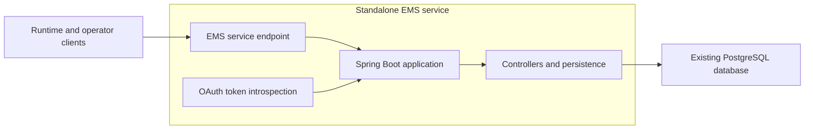

# Deploy the Experiment Management Service

This guide is for the owner of a dedicated EMS control-plane deployment. Build the standalone Spring Boot application
from the EMS server repository, then connect it to the deployment's PostgreSQL database, identity provider, observability, and delivery system.

Do not follow this guide in an algorithm project or serving application. Algorithm projects publish JARs. Serving
applications embed `hotvect-online-util`. The EMS repository owns the server implementation and deployment.

Read [EMS control plane](../../components/experiment-management-service/index.md) first if those boundaries are not yet
clear.

## Target deployment



The server, migrations, security configuration, OpenAPI metadata, image build, and delivery configuration evolve in
one repository. Hotvect supplies compatible runtime and operator clients, not the EMS server artifact.

## 1. Work in the EMS repository

Use a feature branch of the EMS server repository. The relevant server code is under `ems-server/`; the
same repository also contains its clients, web UI, deployment manifests, and coordinated version metadata.

Do not copy the server into Hotvect or add it to an algorithm project. Cross-repository changes should preserve the
deployed HTTP contract and be coordinated through explicit EMS and Hotvect releases.

## 2. Review the standalone application change

For a server upgrade, review the complete application boundary:

- controllers, services, repositories, and API models under `ems-server/src/`;
- Flyway migrations under `ems-server/src/main/resources/db/migration/`;
- production, local, documentation, and test profiles;
- OAuth scope and token-introspection configuration;
- generated OpenAPI and deployment-owned API metadata;
- the executable JAR, Dockerfile, and delivery configuration.

The repository validates that its Java, admin-client, and web-UI versions agree. Bump them together when the release
changes their shared API or deployment contract.

## 3. Connect the existing PostgreSQL database

Production configuration requires:

| Variable | Purpose |
| --- | --- |
| `DB_HOST` | PostgreSQL service host |
| `DB_NAME` | Existing EMS database |
| `DB_SCHEMA` | Existing EMS schema managed by Flyway |
| `DB_USER`, `DB_PASSWORD` | Credentials for the deployment identity |
| `READ_SCOPE`, `WRITE_SCOPE` | Authorization expressions for read and mutation requests |
| `ZALANDO_TOKEN_INFO_URI` | OAuth token-introspection endpoint |

Point the upgraded application at the current EMS database. Do not provision a replacement database as part of a code
move or framework upgrade.

Flyway owns schema evolution and JPA validates the resulting schema. Keep automatic schema generation disabled in
production. Before deploying a version with a destructive migration:

1. inspect the migration in the EMS change;
2. confirm the affected production data and compatibility assumptions;
3. verify a current backup and restore path;
4. deploy only after dependent clients are compatible.

The deployment owner retains responsibility for PostgreSQL availability, backups, retention, pooling, network access,
and credential rotation.

## 4. Configure OAuth and scopes

OAuth is enabled in deployed profiles. Configure the environment's token-introspection endpoint and separate read and
write scopes. Serving runtimes should use read-only credentials; release automation and operator tooling should receive
write access only for their owned operations.

Only health and information endpoints should be anonymous. Verify that other management endpoints and application APIs
require the intended scope. Disable OAuth only for isolated local, documentation, or test profiles that are never
deployed.

## 5. Preserve deployment-owned OpenAPI metadata

The EMS application generates its endpoint and schema contract together with deployment-owned metadata:

- API title, contact, audience, and stable API identity;
- production, staging, and local server URLs;
- the OAuth client-credentials flow and scopes used in that environment.

Regenerate the checked-in OpenAPI document from the exact server revision in CI. Do not replace the service identity
with Hotvect project metadata; the deployed API remains owned and operated by the EMS service owner.

## 6. Keep artifact publication separate

EMS stores artifact metadata, not artifact bytes. Before registering an algorithm or parameter:

1. publish the algorithm JAR or parameter ZIP to its immutable artifact location;
2. verify that online runtime credentials can read it;
3. register the exact absolute path with EMS.

Algorithm-parameter creation must provide `absolute_s3_path`. The server does not construct a deployment-specific path
from the algorithm name or parameter ID.

Read [Artifact publication and storage](../../components/artifact-publication-and-storage/index.md).

## 7. Build the server artifact and container

Build the executable server JAR from the EMS repository:

```bash
./gradlew ems-server:bootJar --no-daemon
```

The repository's Dockerfile packages that JAR with the deployment's JVM and observability configuration. Keep the
runtime base image pinned according to the service's supply-chain policy. The EMS delivery pipeline owns image
publication, promotion, and rollout.

## 8. Verify before deployment

Run the standalone server tests and coordinated version check:

```bash
./gradlew ems-server:test validateVersionBump --no-daemon
```

Run PostgreSQL/Testcontainers coverage with Docker available so Flyway, schema validation, uniqueness constraints, and
transactional behavior are exercised against the production database engine.

Verify at least:

```text
GET /api-docs.yaml
GET /health           on the management port
GET /algorithms       with and without a valid token
GET /slots/{slotName}/defaultVariantAndActiveExperiments
```

The suite should also assert:

- unauthenticated access is rejected outside the explicitly public management endpoints;
- read and write scopes are applied to the intended methods;
- the OpenAPI document includes service-owned identity, servers, OAuth flow, and scopes;
- intentionally removed API paths and schema fields are absent;
- the application starts after Flyway has migrated a PostgreSQL schema and JPA validates it.

An in-memory documentation profile proves API generation and basic wiring. It does not replace PostgreSQL migration
coverage.

## 9. Deploy in dependency order

For a coordinated server change:

1. merge and release the EMS repository change;
2. build and promote the exact EMS server image;
3. regenerate and review the OpenAPI document;
4. rerun database and dependent-client checks;
5. deploy through the normal EMS delivery pipeline;
6. verify runtime clients can refresh their existing slots.

If a client must change for a new contract, release a compatible client before the server starts requiring it. A
Hotvect release is not a prerequisite when the existing client contract remains compatible.

Do not manually publish or deploy from a development checkout to bypass this order.

## 10. Connect serving runtimes

Deploying EMS does not make an application use it. Each containing serving application separately embeds
`hotvect-online-util`, configures read credentials and artifact access, and starts its slot refreshers.

Continue with [Connect an online runtime to EMS](../connect-online-runtime-to-ems/index.md).
